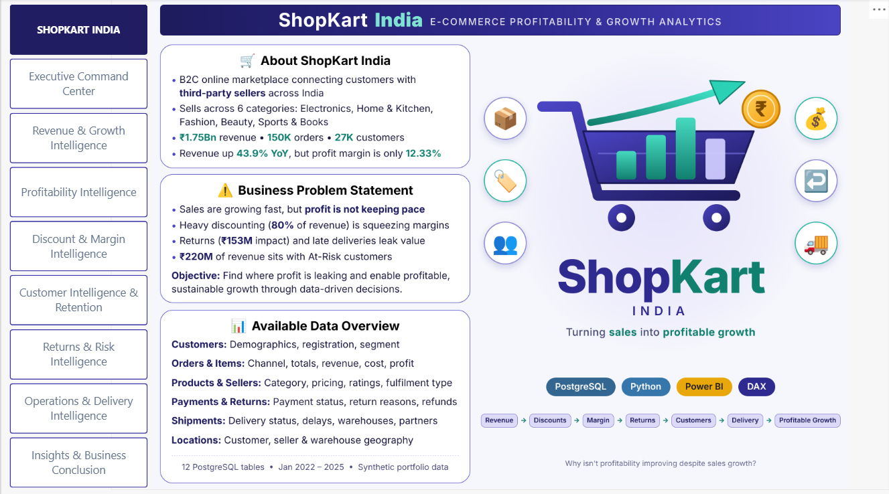
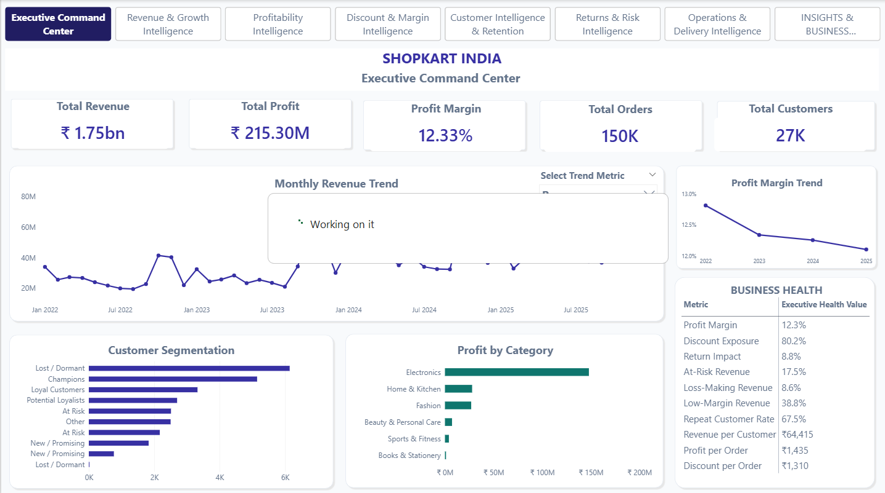
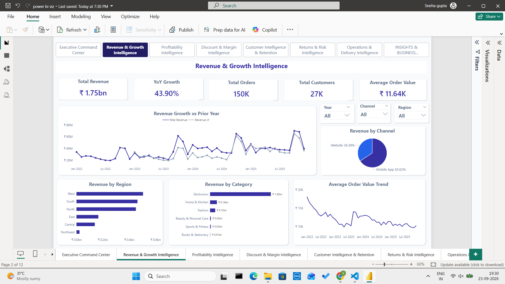
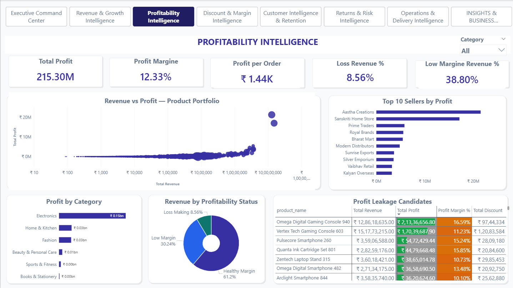
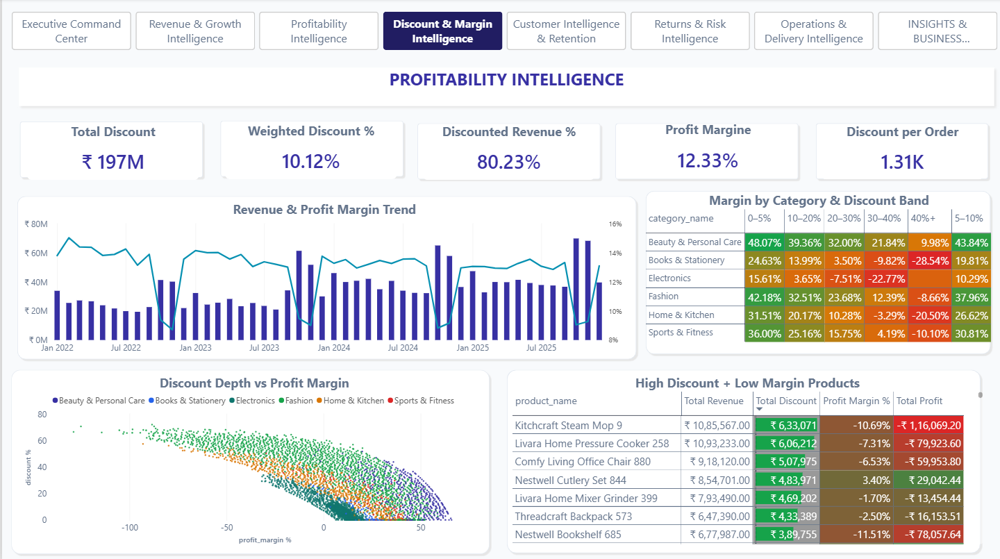
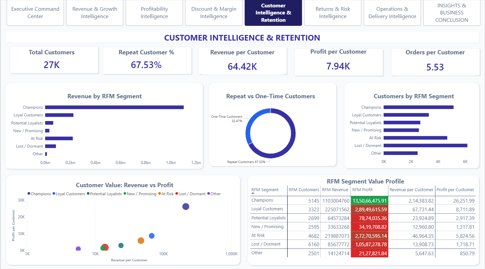
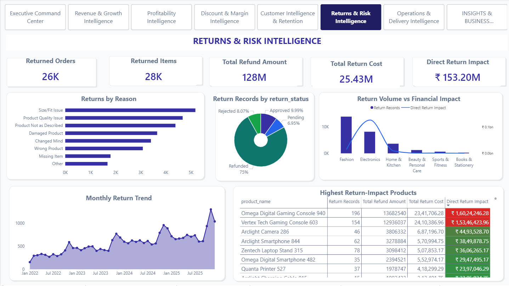
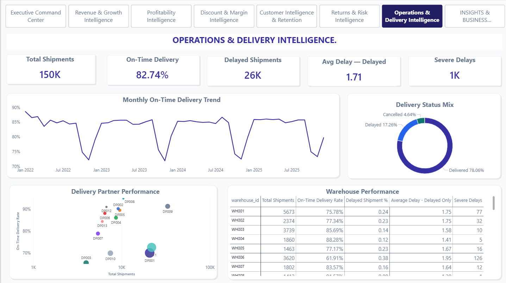
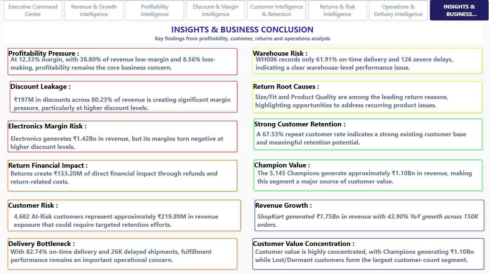

# ShopKart India — E-commerce Profitability & Growth Analytics

> An end-to-end business analytics project investigating why strong e-commerce revenue growth is not translating into proportional profitability improvement.


---

## 📌 Project Overview

**ShopKart India** is a synthetic B2C e-commerce marketplace connecting customers with third-party sellers across India.

The business is experiencing strong sales growth, but profitability is not improving at the same pace.

This project was developed to investigate the business drivers behind this gap and identify where ShopKart may be losing value through:

- Excessive discounting
- Low-margin and loss-making sales
- Customer retention risk
- Product returns and refund-related costs
- Delivery delays and fulfillment inefficiencies

The project follows a complete end-to-end analytics workflow:

**Raw Data → PostgreSQL → Data Validation → SQL Analysis → Python Analytics → Power BI Data Modeling → DAX → Interactive Dashboard → Business Insights**

---

# 🎯 Business Problem

### Central Business Question

> **Why isn't profitability improving despite sales growth?**

ShopKart has achieved significant revenue growth, but the analysis indicates that revenue growth alone is not translating proportionally into stronger profitability.

The project therefore investigates five interconnected business areas:

### 1. Profitability

Which products, categories and sellers generate strong revenue but weak margins?

### 2. Discount Effectiveness

How does increasing discount depth affect revenue and profitability?

### 3. Customer Retention

Which customer segments generate the most value, and which customers are at risk of becoming inactive?

### 4. Returns & Financial Leakage

Which products, categories and return reasons contribute most to refund and return-related costs?

### 5. Delivery & Operations

Which warehouses and delivery partners show weaker fulfillment performance?

---

# 🎯 Business Objective

The primary objective is:

> **Identify opportunities to increase profitable revenue while reducing avoidable leakage from discounting, returns, customer attrition and operational inefficiencies.**

The analysis therefore moves beyond:

> **"How much did ShopKart sell?"**

and asks:

> **"How much of that revenue is actually valuable, sustainable and profitable?"**

---

# 🧭 Analytical Story

The complete project is connected through the following business story:

```text
Strong Revenue Growth
        ↓
Profitability Not Growing Proportionally
        ↓
Discount & Margin Leakage
        ↓
High-Risk Products / Categories
        ↓
Returns & Refund Impact
        ↓
Customer Retention Risk
        ↓
Delivery & Fulfillment Issues
        ↓
Business Opportunities
        ↓
Profitable & Sustainable Growth
```

This business story guided the SQL analysis, Python analysis and final Power BI dashboard.

---

# 📊 Dataset

The dataset is **synthetic** and was created specifically for portfolio analysis in an Indian e-commerce context.

It represents a B2C marketplace containing customers, products, sellers, orders, payments, returns, warehouses and delivery partners.

The PostgreSQL database contains **12 source tables**.

> **Important:** This is synthetic portfolio data and does not represent actual ShopKart company data.

---

# 🗂️ Source Tables

| Table | Purpose |
|---|---|
| `categories` | Product categories and subcategories |
| `customers` | Customer demographics, registration and segmentation |
| `delivery_partners` | Delivery partner information and ratings |
| `locations` | Customer, seller and warehouse location information |
| `order_items` | Transaction-level product sales and profitability |
| `payments` | Payment transactions and payment status |
| `products` | Product master data, pricing and ratings |
| `returns` | Return records, reasons, refunds and return costs |
| `sellers` | Seller information and fulfillment type |
| `shipments` | Shipping, delivery and delay information |
| `warehouses` | Warehouse information and capacity |
| `orders` | Order-level information, channels, totals and status |

---

# 🏗️ Data Architecture

The project follows a layered analytics architecture:

```text
                    RAW SYNTHETIC DATA
                           │
                           ▼
                 ┌───────────────────┐
                 │    PostgreSQL     │
                 │   12 Source       │
                 │      Tables       │
                 └─────────┬─────────┘
                           │
                           ▼
                  DATA VALIDATION
                           │
                           ▼
                  ANALYTICAL SQL
                           │
             ┌─────────────┴─────────────┐
             ▼                           ▼
      Processed Data                Business Analysis
             │                           │
             ▼                           ▼
          Python                    SQL Findings
             │
             ▼
      Statistical Analysis
             │
             ▼
      Portfolio Visualizations
             │
             └─────────────┐
                           ▼
                   POWER BI MODEL
                           │
                           ▼
                    DAX MEASURES
                           │
                           ▼
                 INTERACTIVE REPORT
                           │
                           ▼
                BUSINESS INSIGHTS
```

---

# 🛠️ Tools & Technologies

| Tool / Technology | Purpose |
|---|---|
| **PostgreSQL** | Relational database and analytical SQL |
| **pgAdmin** | Database management and SQL development |
| **Python** | Exploratory and statistical analysis |
| **Pandas** | Data manipulation and transformation |
| **NumPy** | Numerical analysis |
| **SciPy** | Statistical analysis |
| **Matplotlib** | Data visualization |
| **Power Query** | Power BI data preparation |
| **Power BI** | Data modeling, DAX and dashboard development |
| **DAX** | Business metrics and analytical calculations |
| **GitHub** | Version control and project documentation |

---

# 🧩 Step 1 — PostgreSQL Data Modeling

The raw CSV files were loaded into PostgreSQL and structured into a relational schema.

The database uses primary keys, foreign keys and indexes to support analytical queries and maintain data integrity.

The main relationship structure is:

```text
Customers
    │
    └── Orders
            │
            └── Order Items
                    │
                    ├── Products
                    ├── Sellers
                    └── Categories

Orders
    ├── Payments
    ├── Shipments
    │       ├── Warehouses
    │       └── Delivery Partners
    │
    └── Returns
```

The PostgreSQL layer was used for:

- Data validation
- Relationship checks
- Duplicate detection
- Null-value analysis
- Transaction-level validation
- Business KPI calculations
- Profitability analysis
- Discount analysis
- Customer analysis
- RFM segmentation
- Return analysis
- Delivery analysis
- Integrated business diagnosis

---

# 🔍 Step 2 — Data Validation

Before performing business analysis, the dataset was checked for structural and business consistency.

Validation included:

- Row counts
- Duplicate records
- Missing values
- Primary-key uniqueness
- Foreign-key relationships
- Revenue calculations
- Cost calculations
- Profit calculations
- Discount calculations
- Delivery delay calculations
- Relationship coverage between analytical tables

Anomalous values were not automatically deleted.

For example, negative item-level profit was retained because it can represent a genuine business finding rather than a data-quality error.

---

# 🧮 Step 3 — SQL Business Analysis

The SQL analysis was designed around business questions rather than only basic aggregations.

## Product Profitability

Analyzed:

- Revenue
- Cost
- Profit
- Profit margin
- Discount exposure
- Low-margin products
- Loss-making products

## Seller Profitability

Analyzed:

- Seller revenue
- Seller profit
- Seller margin
- Seller contribution
- Seller-level profitability differences

## Discount Effectiveness

Analyzed profitability across discount bands to understand how increasing discount depth affects margins.

## Customer Retention

Created customer-level summaries and RFM metrics based on:

- Recency
- Frequency
- Monetary value

## Returns

Analyzed:

- Return volume
- Return reasons
- Refund amounts
- Return costs
- Product-level return impact
- Category-level return behavior

## Delivery Operations

Analyzed:

- Delivery status
- Delivery delays
- On-time performance
- Warehouse performance
- Delivery partner performance
- Severe delays

---

# 🐍 Step 4 — Python Analytics

Python was used to move beyond SQL aggregation and perform deeper analytical exploration.

The main notebook follows a structured 12-section workflow:

```text
01. Environment & Dataset Loading
02. Data Quality & Structural Analysis
03. Business KPI Overview
04. Time-Series & Growth Analysis
05. Profitability Analysis
06. Discount Effectiveness
07. Customer & RFM Analytics
08. Returns & Refund Analysis
09. Integrated Business Diagnosis
10. Statistical Analysis
11. Portfolio Visualizations
12. Final Business Findings
```

Python was used for:

- Data quality analysis
- KPI analysis
- Time-series analysis
- Profitability analysis
- Discount analysis
- Customer segmentation
- Return analysis
- Statistical analysis
- Business-focused visualization
- Evidence tables
- Integrated business diagnosis

---

# 📐 Step 5 — Power BI Data Model

The final Power BI report uses a dimensional analytical model.

## Fact Tables

- `FactSales`
- `FactReturns`
- `shipments`

## Dimension Tables

- `DimDate`
- `DimCustomer`
- `DimProduct`
- `DimSeller`
- `DimOrder`
- `DimWarehouse`
- `DimDeliveryPartner`
- `DimRFMSegment`

## Supporting Tables

- `_Measures`
- `MonthlyValidation`
- `ProductValidation`

The Power BI model contains dedicated DAX measures for:

- Revenue
- Cost
- Profit
- Profit Margin
- Orders
- Customers
- AOV
- Revenue Growth
- Profit Growth
- Discount Exposure
- Loss-Making Revenue
- Low-Margin Revenue
- Customer Retention
- RFM Analysis
- Return Impact
- Delivery Performance

---

# 📊 Key DAX Metrics

Major measures developed for the Power BI model include:

```text
Total Revenue
Total Cost
Total Profit
Profit Margin %
Total Orders
Total Customers
Units Sold
AOV
Profit per Order
Profit per Customer

Loss Making Revenue %
Low Margin Revenue %

Revenue YoY %
Profit YoY %
Revenue MoM %

Repeat Customer %
At Risk Customers
At Risk Revenue

Returned Orders
Returned Items
Total Refund Amount
Total Return Cost
Direct Return Impact

On-Time Delivery Rate
Delayed Shipment %
Average Delivery Delay
Severe Delays
```

A dedicated `_Measures` table was used to organize the DAX measures.

---

# 👥 RFM Customer Segmentation

Customer behavior was analyzed using an RFM framework.

### Recency

How recently did the customer purchase?

### Frequency

How often did the customer purchase?

### Monetary

How much value did the customer generate?

Customers were scored from **1–5** across the three dimensions.

The resulting customer segments include:

- Champions
- Loyal Customers
- Potential Loyalists
- New / Promising
- At Risk
- Lost / Dormant
- Other

> RFM segmentation is a heuristic analytical framework. The thresholds used in this project are analytical choices and should be recalibrated for a real business.

---

# 📈 Power BI Dashboard

The final Power BI report contains a **Home page** and **8 primary analytical pages** supported by drill-through/detail pages.

---

## 00 — Home

The Home page introduces ShopKart India, the central business problem and the available data, and acts as the navigation hub for all analytical pages.

It includes:

- About ShopKart India
- Business Problem Statement and Objective
- Available Data Overview (12 PostgreSQL tables)
- Page navigation

### Business Question

> **What is ShopKart India, and what problem does this analysis solve?**

---

## 01 — Executive Command Center

The Executive Command Center provides an overview of overall business health.

It focuses on:

- Revenue
- Profit
- Profit margin
- Orders
- Customers
- Business health
- Customer segmentation
- Category profitability
- Overall trends

### Business Question

> **What is happening to the business overall?**

---

## 02 — Revenue & Growth Intelligence

This page investigates the revenue-growth story.

It includes:

- Total Revenue
- Revenue YoY %
- Total Orders
- Total Customers
- AOV
- Revenue growth trend
- Revenue by channel
- Revenue by region
- Revenue by category
- AOV trend

### Business Question

> **Where is ShopKart's growth coming from?**

---

## 03 — Profitability Intelligence

This page moves from revenue performance to profitability.

It analyzes:

- Total Profit
- Profit Margin
- Profit per Order
- Loss-Making Revenue
- Low-Margin Revenue
- Product profitability
- Category profitability
- Seller profitability
- Profitability status

### Business Question

> **Which parts of the business are actually creating profit?**

---

## 04 — Discount & Margin Intelligence

This page investigates the relationship between discount depth and profitability.

It analyzes:

- Total Discount
- Weighted Discount %
- Discounted Revenue %
- Profit Margin %
- Discount per Order
- Discount bands
- Category-level discount behavior
- Discount vs Profit Margin
- High-discount / low-margin products

### Business Question

> **Where are discounts helping sales, and where are they destroying margin?**

---

## 05 — Customer Intelligence & Retention

This page focuses on customer value and retention.

It analyzes:

- Total Customers
- Repeat Customer %
- Revenue per Customer
- Profit per Customer
- Orders per Customer
- RFM segments
- Customer value
- Repeat vs one-time customers
- At-Risk customers

### Business Question

> **Which customers create the most value, and where is retention risk concentrated?**

---

## 06 — Returns & Risk Intelligence

This page investigates return behavior and its financial impact.

It includes:

- Returned Orders
- Returned Items
- Total Refund Amount
- Total Return Cost
- Direct Return Impact
- Return Reasons
- Return Status
- Return Trends
- Product-level return impact

### Business Question

> **Where is ShopKart losing value through returns?**

---

## 07 — Operations & Delivery Intelligence

This page connects commercial performance with operational execution.

It includes:

- Total Shipments
- On-Time Delivery
- Delayed Shipments
- Average Delay
- Severe Delays
- Delivery Status
- Delivery Partner Performance
- Warehouse Performance
- Monthly Delivery Trend

### Business Question

> **Where are fulfillment bottlenecks affecting operational performance?**

---

## 08 — Insights & Business Conclusion

The final page consolidates the most important findings from the complete analysis.

Findings are categorized by business significance:

🔴 **Critical**

🟠 **High Attention**

🟡 **Watch**

🟢 **Positive**

🔵 **Strategic Insight**

This page connects the findings from the previous seven pages into one final business story.

---

# 📌 Key Business Findings

## 1. Strong Revenue Growth

ShopKart generated approximately:

**₹1.75Bn Revenue**

with:

**43.90% YoY Growth**

across approximately:

**150K Orders**

The business therefore has strong revenue momentum, but the profitability analysis shows that growth is not translating proportionally into margin expansion.

---

## 2. Profitability Remains Under Pressure

ShopKart generated approximately:

- **₹215.30M Profit**
- **12.33% Profit Margin**

At the same time:

- **38.80% of revenue is low-margin**
- **8.56% of revenue is loss-making**

This indicates that the key challenge is not simply generating more revenue, but improving the **quality and profitability of existing revenue**.

---

## 3. Discounting Is a Major Source of Margin Pressure

The analysis shows:

- **₹197M Total Discounts**
- **80.23% Discounted Revenue**
- **10.12% Weighted Discount**

Discount sensitivity is particularly visible in Electronics, where profitability declines substantially at higher discount levels.

This indicates that discount strategy should be evaluated alongside:

- Product margin
- Category economics
- Product profitability
- Discount depth

rather than applying uniform discounting.

---

## 4. Electronics Is the Largest Revenue Category but Also a Risk Area

Electronics generates approximately:

**₹1.42Bn Revenue**

making it the dominant revenue category.

However, profitability becomes increasingly sensitive to higher discount levels, with negative margins appearing at higher discount bands.

This creates a business tension:

```text
High Revenue
      ↓
High Sales Volume
      ↓
High Discount Exposure
      ↓
Margin Pressure
```

Electronics therefore requires closer SKU-level monitoring of:

- Revenue
- Discount
- Margin
- Returns

---

## 5. Customer Retention Is Relatively Strong

The overall repeat customer rate is approximately:

**67.53%**

This indicates that a substantial proportion of customers have made more than one purchase.

However, the customer analysis also identifies specific segments requiring attention.

---

## 6. At-Risk Customers Represent Significant Revenue Exposure

The RFM analysis identifies:

**4,682 At-Risk Customers**

representing approximately:

**₹219.89M Revenue Exposure**

This indicates that retention analysis should consider not only customer count but also the financial value associated with those customers.

---

## 7. Champions Represent Significant Customer Value

The Champions segment contains approximately:

**5,145 Customers**

and generates approximately:

**₹1.10Bn Revenue**

This makes the Champions segment a major source of customer value and an important segment to protect.

---

## 8. Returns Create Significant Financial Impact

The analysis identifies approximately:

**₹153.20M Direct Return Impact**

consisting of:

- Approximately ₹128M in refunds
- Approximately ₹25.43M in return costs

Major return reasons include:

- Size / Fit
- Product Quality
- Not as Described
- Damaged
- Changed Mind
- Wrong Product
- Missing Item

This shows that return management is not only an operational issue but also a financial one.

---

## 9. Delivery Performance Has Clear Bottlenecks

Overall:

**82.74% On-Time Delivery**

The analysis identifies approximately:

- **26K Delayed Shipments**
- **1K Severe Delays**

Performance varies considerably across warehouses and delivery partners.

For example:

**WH006 records approximately 61.91% on-time delivery and 126 severe delays.**

This indicates that operational performance should be investigated at the warehouse and delivery-partner level rather than only through an overall company-wide metric.

---

# 🔗 Connecting the Findings

The most important conclusion comes from looking at all findings together.

These are not five isolated problems.

They are connected:

```text
                    REVENUE GROWTH
                          │
                          ▼
                   ₹1.75Bn Revenue
                          │
                          ▼
                HIGH DISCOUNT EXPOSURE
                          │
                          ▼
                 MARGIN COMPRESSION
                          │
             ┌────────────┴────────────┐
             ▼                         ▼
      PRODUCT PROFITABILITY         RETURNS
             │                         │
             ▼                         ▼
      ELECTRONICS RISK          ₹153.20M IMPACT
             │                         │
             └────────────┬────────────┘
                          ▼
                  REVENUE QUALITY
                          │
                ┌─────────┴─────────┐
                ▼                   ▼
        CUSTOMER RETENTION      OPERATIONS
                │                   │
                ▼                   ▼
       ₹219.89M AT-RISK        26K DELAYS
          EXPOSURE
                │                   │
                └─────────┬─────────┘
                          ▼
                 PROFITABLE GROWTH
```

The overall business story is therefore:

> **ShopKart is growing, but the next stage of growth depends on improving revenue quality rather than simply increasing sales volume.**

---

# 💡 Business Recommendations

## 1. Improve Discount Discipline

Instead of applying broad discounts, evaluate discount depth against:

- Product margin
- Category
- Product demand
- Seller economics
- Incremental sales value

High-discount, low-margin products should receive closer monitoring.

---

## 2. Protect High-Value Customers

Retention strategies should prioritize valuable customers within the At-Risk segment.

Customer actions can be differentiated using:

- Recency
- Frequency
- Monetary value
- Historical profitability

---

## 3. Reduce Product Return Leakage

High-impact products and recurring return reasons should be investigated at SKU level.

Potential areas for investigation include:

- Product descriptions
- Product specifications
- Product quality
- Packaging
- Customer expectations
- Size / fit information
- Seller-level fulfillment

---

## 4. Improve Fulfillment Performance

Operational improvement should prioritize:

- Low-performing warehouses
- High-volume delivery partners
- Severe-delay locations
- Recurring delivery bottlenecks

The goal is to identify where operational intervention can have the greatest impact.

---

## 5. Shift From Revenue Growth to Revenue Quality

The broader opportunity is to move from:

> **"Sell more"**

toward:

> **"Generate more profitable, sustainable and lower-leakage revenue."**

This means evaluating growth together with:

- Profitability
- Discount exposure
- Customer value
- Return impact
- Operational performance

---

# 📋 Repository Structure

```text
ShopKart_India_Analytics/
│
├── README.md
├── requirements.txt
├── .gitignore
│
├── powerbi/
│   ├── ShopKart_India_Ecommerce_Analytics.pbix
│   └── dashboard_preview.pdf
│
├── sql/
│   ├── 01_schema.sql
│   ├── 02_validation.sql
│   ├── 03_analysis.sql
│   └── README.md
│
├── python/
│   └── ShopKart_India_Python_Analysis.ipynb
│
├── data/
│   └── processed/
│       ├── shopkart_order_item_analysis.csv
│       ├── shopkart_monthly_performance.csv
│       ├── shopkart_customer_rfm.csv
│       ├── shopkart_product_performance.csv
│       └── shopkart_returns.csv
│
├── docs/
│   ├── business_findings.md
│   └── data_dictionary.md
│
└── images/
    ├── home.png
    ├── executive_command_center.png
    ├── revenue_growth.png
    ├── profitability.png
    ├── discount_margin.png
    ├── customer_retention.png
    ├── returns_risk.png
    ├── operations_delivery.png
    └── insights_conclusion.png
```

---

# ▶️ How to Reproduce the Project

## 1. PostgreSQL

Create the PostgreSQL database/schema and load the source tables.

Run the SQL scripts in the following order:

```text
01_schema.sql
      ↓
02_validation.sql
      ↓
03_analysis.sql
```

The SQL layer creates the analytical structures used by the Python and Power BI stages.

---

## 2. Python

Install the required packages:

```bash
pip install -r requirements.txt
```

Open:

```text
python/ShopKart_India_Python_Analysis.ipynb
```

Run the notebook from top to bottom.

If your local folder structure differs, update the dataset paths inside the notebook.

---

## 3. Power BI

Open:

```text
powerbi/ShopKart_India_Ecommerce_Analytics.pbix
```

Confirm the source paths and refresh the model if required.

The Power BI report contains the complete interactive dashboard and drill-through pages.

---

# 📷 Dashboard Preview

## Home



## Executive Command Center



## Revenue & Growth Intelligence



## Profitability Intelligence



## Discount & Margin Intelligence



## Customer Intelligence & Retention



## Returns & Risk Intelligence



## Operations & Delivery Intelligence



## Insights & Business Conclusion



---

# ⚠️ Data & Analytical Limitations

## Synthetic Dataset

The dataset is synthetic and does not represent actual ShopKart company data.

The findings are intended to demonstrate an end-to-end analytics workflow.

## Association vs Causation

Observed relationships do not automatically establish causality.

For example, an association between delivery delays and customer behavior should not be interpreted as proof that delivery delays caused customer churn without further causal analysis.

## RFM Is Heuristic

RFM segment thresholds are analytical choices and may need to be recalibrated for a real business.

## Return Impact Definition

Direct Return Impact is defined as:

```text
Refund Amount + Return Cost
```

It does not account for potential product recovery, resale or salvage value.

Therefore, it should not automatically be interpreted as the company's complete net financial loss.

## Different Business Dates

Sales and returns use different event dates where applicable.

Therefore, date-filtered comparisons between sales and return metrics should be interpreted carefully.

## Transaction-Level Pricing

Transaction-level selling prices can differ from product master prices because prices may change over time.

---

# 📚 Skills Demonstrated

## SQL

- PostgreSQL
- Relational data modeling
- Primary and foreign keys
- Joins
- Aggregations
- CTEs
- Window functions
- Business KPI calculations
- Analytical views
- Data validation

## Python

- Pandas
- NumPy
- Data cleaning
- Exploratory Data Analysis
- Time-series analysis
- Statistical analysis
- Customer segmentation
- Visualization
- Business insight generation

## Power BI

- Power Query
- Dimensional data modeling
- Star-schema concepts
- Relationships
- DAX
- Time intelligence
- RFM segmentation
- Conditional formatting
- Drill-through pages
- Interactive navigation
- Executive dashboard design

## Business Analytics

- Revenue analysis
- Profitability analysis
- Discount effectiveness
- Customer retention
- RFM analysis
- Return analysis
- Operational analytics
- Business diagnosis
- Insight communication

---

# 🧠 What This Project Demonstrates

The goal of this project was not simply to create charts.

It demonstrates the ability to move through the complete analytics lifecycle:

```text
Business Problem
       ↓
Data Understanding
       ↓
Data Modeling
       ↓
Data Validation
       ↓
SQL Analysis
       ↓
Python Exploration
       ↓
Statistical Analysis
       ↓
Power BI Modeling
       ↓
DAX
       ↓
Dashboard Storytelling
       ↓
Business Findings
       ↓
Business Recommendations
```

The final outcome is an **end-to-end business intelligence project**, rather than a standalone visualization exercise.

---

# 📦 Project Deliverables

This project includes:

- PostgreSQL database schema
- SQL validation queries
- SQL analytical queries
- Processed analytical datasets
- Python analysis notebook
- Statistical analysis
- Power BI semantic model
- DAX measures
- Interactive Power BI dashboard
- Drill-through/detail pages
- Business findings
- Business recommendations
- Data dictionary
- Project documentation

---

# 👩‍💻 Author

## Sneha Gupta

**B.Sc. Data Science**

### Areas of Interest

- Data Analytics
- Business Intelligence
- SQL
- Python
- Power BI
- Data-driven Business Problem Solving

---

# ⭐ Project Summary

> **ShopKart India demonstrates how an end-to-end analytics workflow can transform raw e-commerce transaction data into business insights around profitable growth, discount leakage, customer retention, returns and operational performance.**

The key business takeaway is:

> **ShopKart's next growth opportunity is not simply increasing sales — it is converting existing sales into more profitable, sustainable and lower-leakage revenue.**

---

**Built with PostgreSQL • Python • Power BI • DAX**
